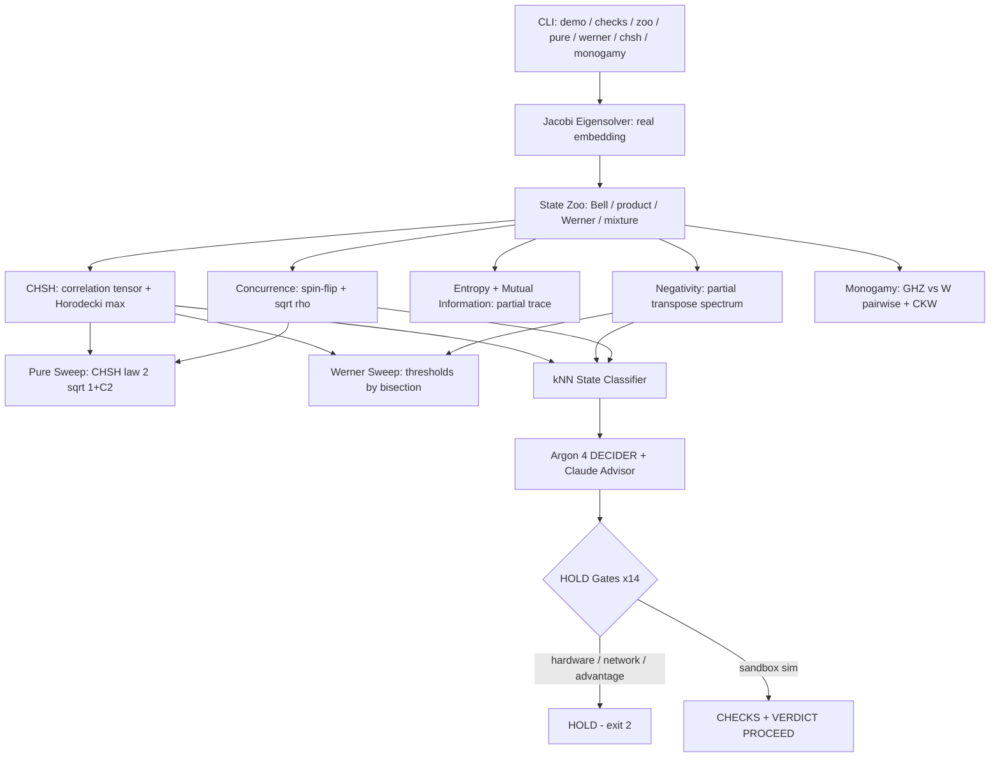
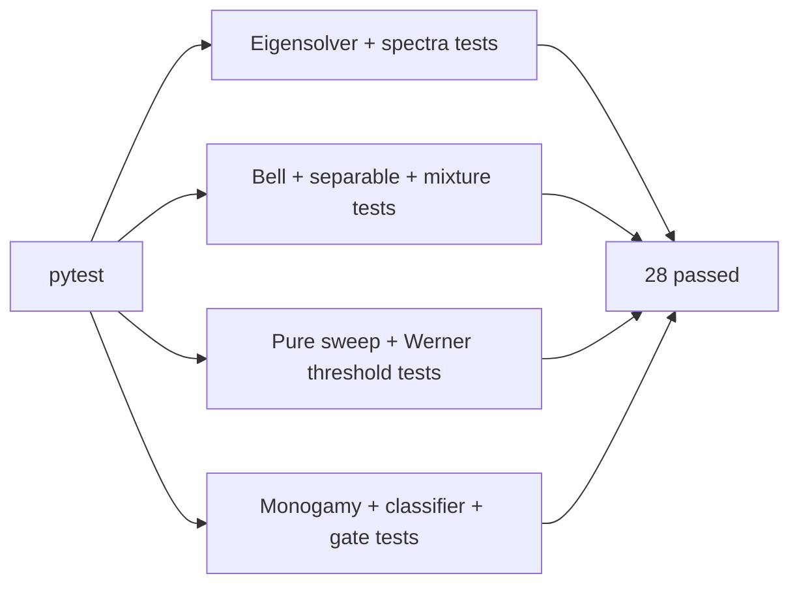
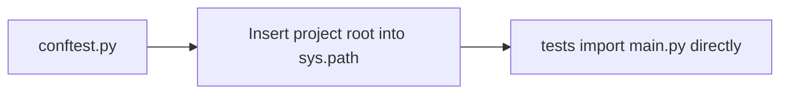
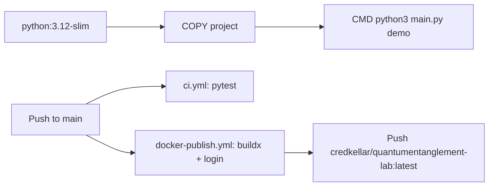

# QuantumEntanglement-Lab 🔗⚛️

**Entanglement Measures Lab** — by Darion Kellar

QuantumEntanglement-Lab is an **educational entanglement-measures lab** in ONE pure-Python file. It takes the word "entangled" — usually left as a vibe — and turns it into **numbers you can recompute**: Wootters **concurrence** and the **entanglement of formation**, **negativity** from the partial transpose, the **von Neumann entropy** of the reduced state, **mutual information**, the **Horodecki CHSH maximum** from the correlation tensor, and the **CKW monogamy** balance for three-qubit states. 🔬

Everything is computed from scratch: density matrices are plain lists of complex numbers, and every spectrum comes from a **cyclic Jacobi eigensolver** running on the real embedding of the Hermitian matrix — no library diagonalises anything behind your back. An 11-state **zoo** is measured by one code path, two families are **swept** (a pure family and the Werner family), two **thresholds are located by bisection** on the computed measures, and a from-scratch kNN classifier labels states with the lab's own verdict policy.

Honest scope, stated up front: a measure is **a number about a state on paper** — no photon was entangled, no device was benchmarked, and no number here specifies any hardware, network, or protocol. And the zoo prints the discipline's favourite warning with numbers attached: the classically correlated mixture carries a full bit of mutual information (**MI = 1.000000**) with concurrence **exactly zero** — correlation is not entanglement. Every hardware / network / cryptographic / advantage use sits behind a permanent HOLD gate (14 total). 🔒

[](https://github.com/kimanicollier44-cmyk/QuantumEntanglement-Lab/actions/workflows/ci.yml)
[](https://github.com/kimanicollier44-cmyk/QuantumEntanglement-Lab/actions/workflows/docker-publish.yml)

> ℹ️ These are the **live** workflow badges for this repo. They activate as soon as the `ci.yml` and `docker-publish.yml` files from the paste pack are pasted into `.github/workflows/` — until then they have nothing to report yet.

## 🧰 Tech Stack Badges & Full Architecture Tech Stack

### 💻 Core Programming Languages & Core Systems


- 🐍 Python 3.12, pure standard library (`math`, `hashlib`, `json`, `sys`) — zero dependencies, zero network, deterministic (double-run byte-identical)
- 🔢 Linear-algebra core from scratch: complex density matrices as plain lists, a cyclic Jacobi eigensolver on the real embedding `[[Re, −Im], [Im, Re]]` for every Hermitian spectrum (eigenvalues arrive in exact pairs; one complex eigenvector per pair is recovered by greedy independence selection, including inside degenerate subspaces) — reconstruction of a Bell state from its eigendecomposition is asserted in CHECKS before any measure is trusted
- ⚛️ Measures core: Wootters concurrence via `sqrt(ρ)·ρ̃·sqrt(ρ)`, entanglement of formation from the binary-entropy closed form, negativity from the partial-transpose spectrum, von Neumann entropy, mutual information, the correlation tensor `T[i][j] = Tr(ρ σi⊗σj)`, and the Horodecki maximum `2√(m1 + m2)` — every headline number asserted against its analytic value in CHECKS
- 🗺️ Sweeps + thresholds: the pure family `cos θ|00⟩ + sin θ|11⟩` and the Werner family measured point by point, with the separability threshold (w = 1/3) and the CHSH threshold (w = 1/√2) located by bisection on the computed measures, not quoted
- 🧠 TinyML kNN state classifier (from scratch, stdlib, distance-weighted): separable / entangled-local / nonlocal / maximally-entangled from (concurrence, negativity, CHSH), labels from the lab's own policy
- 🪑 Council seats: Gemini Argon 4 DECIDER (names-only, tighten-only) + Muse advisor (never overrides HOLD) + Google Flow plan-only (rendered = False, live = 0)

### ⛓️ Web3 & Infrastructure

- 🚫 **Not applicable — honestly.** No blockchain, no Web3, no tokens: the "infrastructure" in this lab is a labelled evaluation of density matrices inside one offline file. Quantum-network deployment is a permanent HOLD gate, not a feature. No fake badges here.

### ⚙️ Platform Support & Hardware Architecture


- 🖥️ Pure Python — runs anywhere Python 3.12+ runs (Linux, macOS, Windows), plus the `python:3.12-slim` Docker image
- 🔒 No hardware is controlled, ever: real sources, detectors, repeaters, and quantum processors are permanent HOLD gates (see the gate table below)

### ⚡ Low-Level Infrastructure & Performance

- 🚫 **No low-level code — honestly.** No C, no C++, no GPU, no compiled extensions: this is one interpreted Python file on purpose, so every eigenvalue can be read, checked, and diffed. Performance here means honest algorithms — a cyclic Jacobi solver, exact partial traces by index bookkeeping, and bisection threshold searches — all deterministic and byte-identical between runs.

### 🛠️ DevOps & Build Tools


- 🐳 Docker (`python:3.12-slim`), GitHub Actions CI + Docker Publish (delivered in the paste pack)
- 🎯 Target image: `credkellar/quantumentanglement-lab:latest`
- 🧪 Tests: `pytest` (28 tests) + the built-in CHECKS suite (97 checks) in `main.py`

### ☁️ Cloud Providers

- 🚫 **None — honestly.** No cloud provider is used or needed: the lab runs fully offline on your own machine or in a local Docker container. Docker Hub appears only as the registry the publish workflow pushes the image to.

## What this does?

1. 🧮 **Linear algebra with its papers in order** — before any physics, the eigensolver must prove itself: the σy spectrum comes out at exactly ±1, a Bell state's spectrum is (1, 0, 0, 0), and the state is reconstructed from its own eigendecomposition to < 1e-9. Every density matrix in the zoo also has to show trace exactly 1.
2. 🏛️ **The state zoo** — 11 states measured by one code path: the 4 Bell states, two product states, a pure-family point at θ = π/6, Werner states at w = 0.50 and w = 0.80, the classically correlated mixture, and the maximally mixed state. Each gets the full card: concurrence, EoF, negativity, reduced entropy, mutual information, CHSH maximum.
3. 🏆 **Bell states max everything** — C = **1.000000**, EoF = **1.000000**, N = **0.500000**, reduced entropy **1.000000**, MI = **2.000000**, CHSH = **2.828427** (the Tsirelson bound 2√2). They are the yardstick every other state in the zoo is read against.
4. 🎭 **The classical mixture tells the truth about correlation** — (|00⟩⟨00| + |11⟩⟨11|)/2 has C = **0.000000** and N = **0.000000** but MI = **1.000000**: perfectly correlated, not entangled at all. Any tool that reports "correlation" as "entanglement" fails this row.
5. 🌊 **The pure family sweep** — cos θ|00⟩ + sin θ|11⟩ at 13 points of θ: concurrence traces |sin 2θ| exactly, negativity is C/2 at every point, and EoF equals the reduced-state entropy at every point — three independent routes agreeing, asserted in CHECKS.
6. ⚖️ **The CHSH law, verified not quoted** — for pure two-qubit states the Horodecki maximum obeys CHSH_max = 2√(1 + C²) exactly. Across all 13 sweep points the computed value matches the law with worst error **5.6e-09** — the correlation tensor and the spin-flip machinery grading each other.
7. 🎚️ **Werner states and the first threshold** — ρ = w|Φ+⟩⟨Φ+| + (1−w)I/4: concurrence follows max(0, (3w−1)/2) and negativity max(0, (3w−1)/4) at every swept w, and bisection on the computed concurrence locates the separability threshold at **w = 0.333333** (exact 1/3).
8. 🚦 **The second threshold — and the band between** — bisection on the computed CHSH maximum locates the violation threshold at **w = 0.707107** (exact 1/√2). Between 1/3 and 1/√2 the Werner state is **entangled but violates no CHSH inequality** (at w = 0.50: C = 0.250000, CHSH = 1.414214): entanglement and nonlocality are different resources, and the lab shows the band where they come apart.
9. 🪢 **Monogamy: GHZ vs W (CKW)** — for GHZ, every reduced pair has concurrence **0.000000** while C(A|BC) = **1.000000**: no pair holds anything, the triple holds it all. For W, every pair holds **2/3**, C²(A|BC) = **8/9**, and C²(AB) + C²(AC) = 8/9 exactly — the CKW inequality **saturates**. Entanglement is a budget, and the two states spend it in opposite ways.
10. 🏷️ **Classifier + seats + checks** — a distance-weighted kNN labels every zoo state from its measure card (Bell → maximally-entangled, Werner 0.50 → entangled-local, Werner 0.80 → nonlocal, classical mixture → separable), with Argon 4 DECIDER (sha256 trace), Muse advisor, Google Flow plan-only, and a built-in CHECKS suite (97 checks).

## 🗺️ How it works — diagram per script

### `main.py` — the whole lab



### `tests/test_main.py` — verification



### `conftest.py` — test path setup



### `Dockerfile` + CI flow — container & publish



## Why is this cool?

1. 🏆 The Bell states don't just "score high" — they pin every measure to its mathematical ceiling at once (C = 1, CHSH = 2√2, MI = 2), so the zoo has a yardstick that is itself verified.
2. 🎭 It catches the most common lie in quantum popular writing with one row of a table: a state can be perfectly correlated (MI = 1) and completely unentangled (C = 0) at the same time.
3. ⚖️ The CHSH law CHSH_max = 2√(1 + C²) is a theorem the lab *re-derives numerically* — two unrelated computations (spin-flip concurrence, correlation-tensor maximum) agree to 5.6e-09 across a 13-point sweep.
4. 🚦 The Werner band between w = 1/3 and w = 1/√2 is where "entangled" and "nonlocal" stop being synonyms — and both edges of the band are found by bisection on computed measures, not looked up.
5. 🪢 GHZ and W are the yin and yang of three-qubit entanglement: one hides everything in the triple (pairs: 0), the other shares it so evenly that the monogamy budget balances to the last digit (8/9 = 4/9 + 4/9).
6. 🔬 The eigensolver shows its work: spectra, reconstruction, and trace checks run *before* the physics, so a wrong number would be caught by the lab itself, not by a reader.
7. 🎚️ Noise is priced continuously: the Werner sweep turns "decoherence hurts entanglement" into a curve with two exact thresholds and closed forms matched at every point.
8. 🧮 Entanglement of formation is cross-examined three ways on the pure family — Wootters' formula, the reduced entropy, and the sweep — and all three agree, because for pure states they must.
9. 🏷️ The classifier's labels come from the lab's own stated policy over the same three numbers a reader sees — no hidden features, no trained black box, and it agrees with the policy on every zoo state.
10. 🎯 Deterministic end to end: run it twice, get byte-identical output — an entanglement lab you can diff.

## What problems this solves?

1. ❌ **Problem:** "Entangled" is used as an unmeasured adjective in most explainers. ✅ **Solution:** Eleven states get the same six-number measure card from one code path, so the word always has a value attached.
2. ❌ **Problem:** Correlation and entanglement are blurred together constantly. ✅ **Solution:** The classical mixture row prints MI = 1.000000 next to C = 0.000000 — the distinction is a computed fact, not a footnote.
3. ❌ **Problem:** Concurrence is usually hidden inside a library call nobody can audit. ✅ **Solution:** The full Wootters route — spin flip, matrix square root from the lab's own eigendecomposition, eigenvalue ladder — is in the one file, asserted against closed forms.
4. ❌ **Problem:** CHSH is quoted as "2.83 for entangled states", as if all entangled states violate it. ✅ **Solution:** The Werner sweep shows CHSH = 2√2·w crossing 2 only at w = 1/√2, with an entangled-but-local band measured underneath it.
5. ❌ **Problem:** Thresholds like w = 1/3 are memorised, not understood. ✅ **Solution:** Both thresholds are located by bisection on the computed measures and printed next to their exact values.
6. ❌ **Problem:** Monogamy is described in words ("entanglement can't be shared") without arithmetic. ✅ **Solution:** GHZ and W are both fully computed — pairwise concurrences, bipartition concurrence, and the CKW slack, which is exactly 0 for W and exactly 1 for GHZ.
7. ❌ **Problem:** Numerical linear algebra in teaching code is trusted blindly. ✅ **Solution:** The eigensolver is validated first (σy spectrum, Bell reconstruction < 1e-9, trace checks), and the CHSH law gives an independent cross-grade of the whole pipeline.
8. ❌ **Problem:** "How entangled is it?" gets one number when the honest answer is several. ✅ **Solution:** Concurrence, EoF, negativity, reduced entropy, MI, and CHSH are printed together — they agree where theory says they must and differ where it says they should (pure family: N = C/2; Werner: N = C/2 as well, but CHSH peels away at 1/√2).
9. ❌ **Problem:** Simulation tools quietly imply a device or network is next. ✅ **Solution:** 14 named HOLD gates return exit code 2 for every hardware, network, cryptographic, certification, or advantage claim, forever.
10. ❌ **Problem:** Classifier demos train on data nobody can inspect. ✅ **Solution:** The kNN grid is labelled by the lab's own published policy, the zoo verdicts are printed with their measure cards, and agreement between kNN and policy is itself a check.

## How to install this?

1. 📋 Clone or download this project folder.
2. 🐍 Make sure Python 3.12+ is installed: `python3 --version`
3. ▶️ Run the full demo + checks (no arguments needed):

```bash
python3 main.py
```

4. 🧪 Run the test suite:

```bash
pip install pytest
python3 -m pytest -q
```

5. 🎛️ Try the other commands:

```bash
python3 main.py checks    # 97 built-in checks
python3 main.py zoo       # the 11-state zoo, full measure cards (JSON)
python3 main.py pure      # pure family sweep + CHSH law per point (JSON)
python3 main.py werner    # Werner sweep, formulas, both thresholds (JSON)
python3 main.py chsh      # CHSH = 2*sqrt(1 + C^2) verification report (JSON)
python3 main.py monogamy  # GHZ vs W pairwise concurrence + CKW (JSON)
python3 main.py classify  # kNN state classifier report
python3 main.py brains    # Argon 4 + Muse + Flow seats
python3 main.py holds     # list all 14 HOLD gates
python3 main.py hold-demo # exits 2 - gated actions stay HOLD
```

6. 🐳 Or run it in Docker:

```bash
docker build -t credkellar/quantumentanglement-lab:latest .
docker run --rm credkellar/quantumentanglement-lab:latest
```

## Requirements

- 🐍 Python 3.12 or newer
- 📦 Dependencies: **none** (standard library only)
- 🌐 Network: **none** — fully offline
- 🧪 For tests only: `pytest`
- 🐳 Optional: Docker

## FULL project structure tree

```text
quantumentanglement-lab/
├── main.py                  # the whole lab: Jacobi eigensolver, state zoo, concurrence, negativity, entropy, CHSH, monogamy, classifier, seats, HOLD gates
├── conftest.py              # puts the project root on sys.path for tests
├── tests/
│   └── test_main.py         # 28 pytest tests: eigensolver, Bell states, separable states, pure sweep, Werner thresholds, monogamy, gates, determinism
├── assets/
│   └── cover.png            # README cover image (2736 x 912)
├── Dockerfile               # python:3.12-slim, runs the demo
├── .gitignore               # __pycache__/, .pytest_cache/, *.pyc
└── README.md                # this file
```

> 📦 Delivered separately as paste packs (not in this tree): `.github/workflows/ci.yml` + `docker-publish.yml`, and the Docker Hub pack (100-char description, 350-char About, overview, categories).

## 🔒 HOLD gates — all 14, permanent

| # | Gate | What stays held |
|---|------|-----------------|
| 1 | `quantum_network_deployment` | No deploying a quantum network or repeater chain from lab measures |
| 2 | `real_entanglement_distribution` | No distributing real entanglement; these states exist only as matrices |
| 3 | `hardware_benchmark_claim` | A concurrence value is not a benchmark of any physical device |
| 4 | `quantum_advantage_claim` | No quantum-advantage or supremacy claim follows from a paper measure |
| 5 | `qkd_security_claim` | No QKD security guarantee; lab CHSH values certify no real key |
| 6 | `teleportation_service_claim` | No teleportation service or protocol deployment claim |
| 7 | `vendor_device_comparison` | No comparing or ranking real vendor hardware with these numbers |
| 8 | `cryptography_strength_claim` | No cryptographic strength claim for any real system |
| 9 | `device_certification` | No certifying real quantum hardware, sources, or detectors |
| 10 | `sensing_metrology_claim` | No sensing or metrology performance claim from a state on paper |
| 11 | `loophole_free_bell_claim` | A computed CHSH maximum is not a loophole-free Bell test |
| 12 | `investment_claim` | No investment claim; a teaching lab is not a prospectus |
| 13 | `production_system_claim` | No production system may be built or run from this lab |
| 14 | `measure_as_physical_proof_claim` | A measure is a number about a state on paper, never proof about a physical system |

🧑‍⚖️ **Council seats:** Gemini Argon 4 Extended Thinking — DECIDER (names-only, tighten-only, MAP → MODEL → STRESS → DECIDE, sha256 trace, `can_override_hold = False`) · Muse — advisor (`can_override_hold = False`) · Google Flow — plan-only (`rendered = False`, `live = 0`).

✅ **Verification:** pytest **28 passed** (project + clean copy) · built-in CHECKS **97/97** · double-run output **byte-identical** · `hold-demo` exits **2** · `main.py` **986 lines**, pure stdlib, zero network.

## 🧒 5th-grade English section

Imagine you and a friend each have a magic coin. 🪙

- When two coins are **entangled**, they are tied together by an invisible string. Flip yours and it lands heads — your friend's coin, far away, is suddenly tied to yours in a way no ordinary pair of coins can copy. This lab **measures how strong that string is**, with real math. 🧵
- The strongest string of all belongs to the **Bell pairs**. The lab gives them a perfect score of **1** — and checks the score four different ways, like measuring a table with four different rulers to make sure they agree. 📏
- Here is the tricky part the lab proves with numbers: two coins can **match every time** (both heads or both tails) and still have **no magic string at all** — that is just ordinary matching, like twins wearing the same shirt. Matching is called *correlation*. The magic string is called *entanglement*. They are **not the same thing**, and this lab can tell them apart! 👕
- If you mix a magic pair with plain noise — like stirring mud into clear water — the string gets weaker. The lab finds the exact amount of mud where the string **snaps completely**, and a second, bigger amount where the pair stops being able to win a special guessing game called **CHSH**. Between those two amounts, the pair is still tied, but too weakly to win the game. 💧
- With **three** coins, there is a sharing rule: one coin cannot be strongly tied to two others at once. One famous trio (called **GHZ**) keeps the whole string in the middle where no pair can see it. Another trio (called **W**) shares the string evenly, spending its whole budget exactly. 🪢
- This project is a **pretend lab on a computer**. No real magic coins exist here — just honest math that teaches you how scientists measure the string. 💻

---

MIT © 2026 Darion Kellar · QuantumEntanglement-Lab — educational simulation only 🔗
